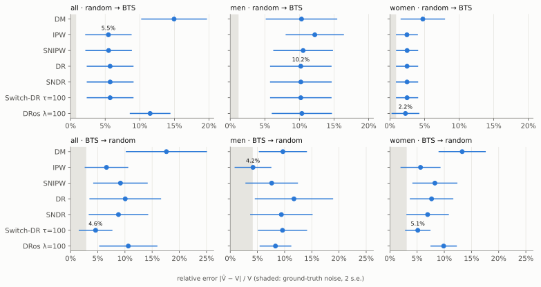
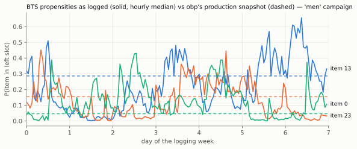
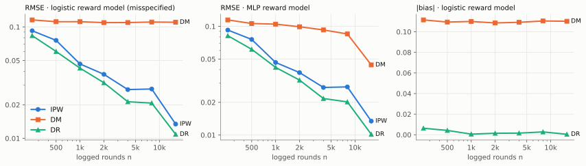
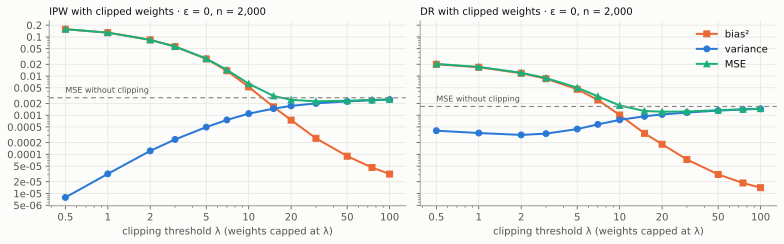

# counterfact

**Off-policy evaluation, implemented from scratch and stress-tested on 26 million real recommendation logs.**

A recommender team has a new ranking policy and a week of logs from the old one. Off-policy
evaluation (OPE) estimates how the new policy *would have* performed from those logs alone,
without shipping it to users. This repository implements the standard OPE estimators from their
definitions (DM, IPW, SNIPW, DR, SNDR, Switch-DR, DRos), a PyTorch reward model with a
hand-written training loop and cross-fitting, and the full benchmark protocol of the
[Open Bandit Dataset](https://arxiv.org/abs/2008.07146) paper (Saito et al., NeurIPS 2021
Datasets & Benchmarks). It runs on the complete 11.7 GB release: 26.9M impressions from
ZOZOTOWN, a Japanese fashion e-commerce platform, logged by two policies running side by side
in an A/B test.

### Findings

- **No estimator wins everywhere.** Across the six benchmark settings (3 campaigns × 2 directions,
  20 bootstrap runs each), the best estimator is IPW twice, Switch-DR three times (tied with DR once)
  and DRos once. The direction of evaluation decides which failure mode dominates.
- **When importance weights explode, the reward model's bias shows.** Evaluating the random policy
  from Thompson-sampling logs means weights up to 29,412. DM overestimates by +9.7% to +17.6% on every
  campaign. Switch-DR, which hands the extreme-weight rounds to the reward model, beats plain DR in
  all three campaigns (4.6% vs 10.1% relative error on "all").
- **When weights are tame, error is bias, not variance.** Evaluating Thompson sampling from
  random logs (weights ≤ 20), IPW, SNIPW, DR, SNDR and Switch-DR agree to within 0.2 points on
  "all" and "women" and within 2 points on "men". Yet they are all ~5% low on "all" and ~10% low
  on "men", far outside the ground truth's noise.
- **Part of that bias is likely the benchmark's own target.** obp evaluates Thompson sampling from one
  parameter snapshot. The policy that actually generated the ground truth re-estimated itself
  through the week: up to 1,895 distinct propensities per (item, slot), and 0.41 to 0.50 median
  total-variation distance from the snapshot. On "all", evaluating the policy *as logged* halves
  the error of every estimator, IPW (5.5% → 2.8%) and the weight-free DM (15.0% → 7.6%) alike.
  On "men" and "women" it makes no improvement, so this is one campaign's evidence, not a general
  result. The "men" gap has some other cause (see [Audit](#audit-which-bts-policy-is-the-ground-truth-for)).
- **The default features hide the signal the policy exploits.** The reward model sees items only
  through shared attributes, so it cannot learn per-item click rates, which are exactly what
  Thompson sampling optimises. Adding a one-hot item id cuts DM's error from 15.0% to 6.7% and
  from 17.6% to 6.3%, and brings Switch-DR to 4.0% with +0.1% bias.



## What's here

| Piece | File | Notes |
|---|---|---|
| Estimators | [`src/counterfact/estimators.py`](src/counterfact/estimators.py) | 7 estimators over 4 per-round vectors; O(n) after one reduction, so bootstraps are cheap |
| Reward model | [`src/counterfact/reward_model.py`](src/counterfact/reward_model.py) | PyTorch click model, custom AdamW loop with early stopping, K-fold cross-fitting, factorised all-items scoring |
| Policies | [`src/counterfact/policies.py`](src/counterfact/policies.py) | Vectorised Monte Carlo of slate Thompson sampling; time-varying policy rebuilt from logged propensities |
| Data | [`src/counterfact/data.py`](src/counterfact/data.py) | Streams the 11.7 GB of CSV straight out of the release zip into 28-byte-per-row arrays: 753 MB, 15× smaller (2.5 min) |
| Synthetic bandit | [`src/counterfact/synthetic.py`](src/counterfact/synthetic.py) | Known ground truth; overlap and model misspecification set independently |
| Benchmark | [`src/counterfact/obd_benchmark.py`](src/counterfact/obd_benchmark.py) | The paper's protocol: estimate one A/B arm's click rate from the other arm's logs |
| Derivations | [`docs/METHOD.md`](docs/METHOD.md) | Unbiasedness, double robustness, variance, why cross-fitting, the slate assumption |
| All numbers | [`results/RESULTS.md`](results/RESULTS.md) | Generated from the result JSONs by `experiments/make_report.py` |

Tests (`pytest`) check the estimators against hand-computed values and against the identities
that tie them together: Switch-DR at τ=∞ is DR and at τ=0 is DM; DRos at λ=∞ is DR and at λ=0
is DM; DR with a zero model is IPW; self-normalised estimators ignore weight scale. Monte Carlo
tests confirm that IPW and DR are unbiased and that DR **stays** unbiased with a badly wrong
reward model while DM does not.

## Results on the Open Bandit Dataset

Both arms of the A/B test ran during the same week on the same three campaigns ("all": 80 items,
"men": 34, "women": 46). Each arm's click rate is a near-exact on-policy value, so one arm's
value is estimated from the *other* arm's logs and scored by relative error |V̂ − V| / V.
Each run bootstraps the logged arm (capped at 1M rows), cross-fits an MLP reward model on it and
applies every estimator. Full protocol: [docs/METHOD.md](docs/METHOD.md#evaluation-protocol-on-the-open-bandit-dataset).

| Estimator | all: random → BTS | men: random → BTS | women: random → BTS | all: BTS → random | men: BTS → random | women: BTS → random |
|---|---|---|---|---|---|---|
| DM | 15.0% ± 4.8% | 10.3% ± 5.2% | 4.8% ± 3.2% | 17.6% ± 7.5% | 9.7% ± 4.4% | 13.3% ± 4.3% |
| IPW | **5.5% ± 3.4%** | 12.2% ± 4.2% | 2.5% ± 1.6% | 6.6% ± 4.0% | **4.2% ± 3.4%** | 5.6% ± 3.7% |
| SNIPW | 5.5% ± 3.4% | 10.5% ± 4.3% | 2.5% ± 1.6% | 9.2% ± 5.0% | 7.6% ± 4.8% | 8.3% ± 4.1% |
| DR | 5.7% ± 3.4% | **10.2% ± 4.4%** | 2.5% ± 1.6% | 10.1% ± 6.6% | 11.7% ± 7.2% | 7.7% ± 4.0% |
| SNDR | 5.7% ± 3.4% | 10.2% ± 4.5% | 2.5% ± 1.6% | 8.8% ± 5.5% | 9.4% ± 5.7% | 6.9% ± 3.9% |
| Switch-DR (τ = 100) | 5.7% ± 3.4% | **10.2% ± 4.4%** | 2.5% ± 1.6% | **4.6% ± 3.1%** | 9.6% ± 4.5% | **5.1% ± 2.3%** |
| DRos (λ = 100) | 11.5% ± 2.9% | 10.3% ± 4.3% | **2.2% ± 2.0%** | 10.6% ± 5.4% | 8.3% ± 2.9% | 9.9% ± 2.4% |
| *ground-truth noise (2 s.e.)* | 0.8% | 1.2% | 0.9% | 2.9% | 4.1% | 3.1% |

Mean ± standard deviation of relative error over 20 bootstrap runs; **bold** is best per column.
Median largest weight per run: 11 to 20 for random → BTS, 12,500 to 29,412 for BTS → random. Out-of-fold
reward-model AUC is 0.55 to 0.66 and calibration (mean prediction / mean click) is 0.99 to 1.01.

**Reading the two directions.**
*Random → BTS* has small weights, so IPW, DR and their variants nearly coincide: the reward-model
term barely moves anything once the weights are reliable. Their shared error is a bias, which is
why the spread across these estimators is far smaller than the error itself. (DRos is the
exception on "all": its λ = 100 shrinkage pulls it towards DM's −15%.)
*BTS → random* is the hard direction. A handful of rounds where BTS showed a disfavoured item
carry weights in the tens of thousands. Self-normalisation and Switch-DR earn their keep here,
while DM is systematically high on every campaign. The reward model is fitted on what BTS chose
to show and extrapolates optimistically to the items it avoided.

### Ablations

Same protocol and seeds, with one thing changed. Full tables: [results/RESULTS.md](results/RESULTS.md).

| Change | Setting | DM | IPW | DR | Switch-DR | Takeaway |
|---|---|---|---|---|---|---|
| none (main table) | all: random → BTS | 15.0% | 5.5% | 5.7% | 5.7% | |
| evaluate BTS **as logged** instead of the snapshot | all: random → BTS | **7.6%** | **2.8%** | **2.8%** | **2.8%** | every estimator moves towards the truth, DM included |
| | men: random → BTS | 11.1% | 12.9% | 11.0% | 11.0% | no change: the "men" gap is not the target |
| | women: random → BTS | 5.0% | 5.1% | 4.7% | 4.7% | slightly worse: within noise of the main table |
| **logistic** reward model instead of MLP | all: random → BTS | 21.9% | 5.5% | 5.5% | 5.5% | DM degrades, weighted estimators unaffected |
| | all: BTS → random | 21.7% | 6.6% | 10.5% | 4.8% | same pattern under huge weights |
| reward model also sees the **item id** | all: random → BTS | **6.7%** | 5.5% | 5.8% | 5.8% | DM error more than halves; DRos 11.5% → 5.4% |
| | all: BTS → random | **6.3%** | 6.6% | 8.9% | **4.0%** | Switch-DR's bias drops to +0.1% |

The first row group is the strongest evidence in the audit below. DM uses no importance
weights at all, so its error halving under the logged target (15.0% → 7.6%) is independent of
IPW's (5.5% → 2.8%). Both point to the logged policy, not the snapshot, being what the ground
truth measures on "all". The logistic row is double robustness on real data: making the reward
model worse (AUC 0.66 → 0.61) costs DM 4 to 7 points and DR at most 0.4.

**Item identity is the reward model's missing feature.** The default item features are three
categorical attributes (only 62 distinct combinations across 80 items) plus a numeric score with
41 distinct values, so many items look identical to the model and it cannot learn a separate
click rate for each one. Thompson sampling exploits exactly those per-item
click rates. Adding a one-hot item id raises AUC only slightly (0.66 → 0.68), but it cuts DM's
error from 15.0% to 6.7% and from 17.6% to 6.3%. Every estimator that leans on the model improves
with it (DRos, Switch-DR). With item ids, all seven estimators on random → BTS show the same −5%
bias. Seven estimators with different failure modes agreeing on one offset points at the target,
not the estimators.

## Audit: which BTS policy is the ground truth for?

obp builds the BTS evaluation policy from one set of Beta parameters (`BernoulliTS(is_zozotown_prior=True)`),
which its README describes as replicating the production policy. The BTS logs disagree:

| Campaign | distinct logged propensities per (item, slot), median / max | TV(snapshot, logged policy) per hour, min / median / max | IPW error, snapshot target | IPW error, logged target | IPW s.e. / V |
|---|---|---|---|---|---|
| all | 498 / 1,845 | 0.16 / 0.50 / 0.63 | 5.2% | 0.9% | 3.1% |
| men | 694 / 1,895 | 0.11 / 0.41 / 0.71 | 10.9% | 11.3% | 3.7% |
| women | 693 / 1,895 | 0.20 / 0.50 / 0.69 | 0.4% | 4.7% | 3.2% |

IPW here uses the entire random log (no bootstrap). The logged target is
`policies.LoggedSlatePolicy`, which replays each (item, slot) propensity BTS logged closest
before each moment.



What this does and doesn't show:

- The snapshot is not the policy that produced the ground truth. The distributions differ at
  every hour of the week, and testing showed the drift is not "snapshot + accumulated clicks":
  adding the week's counts to the prior makes the match worse.
- In terms of **value**, the evidence is mixed. On "all", the logged target moves IPW from 5.2%
  to 0.9% error, but IPW's standard error is 3.1% of V, so on its own that would be weak. It is
  backed up by the bootstrap ablation above, where the weight-free DM moves the same way
  (15.0% → 7.6%). On "women" the logged target moves IPW the other way (0.4% → 4.7%), and on
  "men" not at all. Most items have similar click rates, so very different distributions can have
  similar values. The rebuilt policy is also only approximate (see Limitations).
- The persistent −11% on "men" survives both targets, so it is not a target problem. Candidates
  are the position-independence assumption (BTS and random fill the other two slots very
  differently) and population differences between the arms. This repository does not settle it.

## Results on synthetic data (exact ground truth)

Real data gives one noisy truth per setting. The synthetic bandit in
[`synthetic.py`](src/counterfact/synthetic.py) has a closed-form reward, so bias and variance can
be measured exactly over 100 independent datasets per setting. Its rewards depend on
context × action interactions that a logistic reward model cannot represent.



| Estimator (reward model) | n = 250 | n = 1,000 | n = 4,000 | n = 16,000 |
|---|---|---|---|---|
| IPW | 0.0925 (−0.0087) | 0.0465 (−0.0012) | 0.0274 (+0.0036) | 0.0134 (+0.0000) |
| DM (logistic) | 0.1157 (−0.1115) | 0.1115 (−0.1100) | 0.1096 (−0.1092) | 0.1103 (−0.1102) |
| DM (MLP) | 0.1147 (−0.1101) | 0.1048 (−0.1035) | 0.0927 (−0.0919) | 0.0442 (−0.0418) |
| DR (logistic) | 0.0836 (−0.0063) | 0.0427 (+0.0006) | 0.0213 (+0.0016) | 0.0109 (−0.0005) |
| DR (MLP) | 0.0821 (−0.0056) | 0.0419 (−0.0012) | 0.0217 (+0.0015) | 0.0102 (−0.0004) |

RMSE (bias) with true value V = 0.367. Full table with every estimator: [results/RESULTS.md](results/RESULTS.md).

- **Double robustness, measured.** With the misspecified logistic model, DM is biased by −0.11
  at every sample size. DR built on *the same model* has bias of 0.002 or less in absolute value from n = 1,000.
- **A better model buys variance, not unbiasedness.** DR is unbiased with either model. The MLP
  only helps once it has enough data to fit the interactions (DM-MLP's bias falls from −0.10 to
  −0.04 between n = 1,000 and 16,000).
- **Uncertainty intervals inherit the model's blind spot.** In `examples/quickstart.py`, DM's
  95% bootstrap interval is narrow and misses the truth by 0.11. Bootstrap intervals capture
  sampling noise, not reward-model bias. Every weighted estimator's interval covers the truth.



Clipping weights at λ trades variance for bias. Against a deterministic evaluation policy
(ε = 0, n = 2,000), the best threshold cuts MSE by **19% for IPW (λ = 30)**, **27% for DR
(λ = 20)** and 23% for Switch-DR (τ = 50). DRos is best without shrinkage here. It shrinks
towards DM, and DM is badly biased at this sample size, which is a reminder that every
"variance reduction" borrows from the reward model's accuracy. The overlap study
([figure](results/figures/synthetic_overlap.svg)) shows the same trade from the other side.
As the evaluation policy goes from fully greedy (ε = 0) to ε = 0.75, DM's RMSE falls from 0.155
to 0.017, because the model is no longer asked about actions the logs rarely show. IPW (0.053)
and DR (0.041) stay usable even at ε = 0, and Switch-DR is the best estimator at every ε ≤ 0.5.

## Reproduce

```bash
python -m venv .venv && source .venv/bin/activate      # Windows: .venv\Scripts\activate
pip install torch --index-url https://download.pytorch.org/whl/cpu
pip install -e ".[dev]"
pytest -q
```

Data (413 MB zip, CC BY 4.0, not committed):

```bash
mkdir -p data/download
curl -L -o data/download/open_bandit_dataset.zip https://research.zozo.com/data_release/open_bandit_dataset.zip
python scripts/prepare_data.py --source data/download/open_bandit_dataset.zip
```

Experiments (CPU only; times on a 12-thread laptop):

```bash
python experiments/bts_policy_audit.py                                                        # ~1 min
python experiments/synthetic_study.py --study sample_size                                     # ~5 min
python experiments/synthetic_study.py --study overlap                                         # ~1 min
python experiments/synthetic_study.py --study clipping                                        # <1 min
python experiments/obd_benchmark.py --tag main                                                # ~35 min
python experiments/obd_benchmark.py --tag target --directions random_to_bts --target replayed # ~30 min
python experiments/obd_benchmark.py --tag logistic --campaigns all --hidden                    # ~10 min
python experiments/obd_benchmark.py --tag itemids --campaigns all --item-ids                  # ~30 min
python experiments/make_report.py                                                             # figures + results/RESULTS.md
```

## Design decisions

- **Estimators consume four vectors, not matrices.** Every estimator here is a function of
  the weight $w_i$, the reward, the model's prediction for the logged action, and the model's
  prediction averaged over $\pi_e$. `OPEInput.build` reduces the $(n, |\mathcal A|)$ policy and
  model matrices once, so a 1,000-sample bootstrap of a 1M-row log never touches 80M-entry arrays.
- **No class reweighting for 0.4% click rates.** DM and DR use the predicted probabilities as
  values, so calibration matters more than ranking. The output bias starts at the base-rate logit
  instead, and out-of-fold calibration is logged for every run (it stays within a few percent of 1).
- **Cross-fitting by default.** DR's unbiasedness argument needs the reward model to be
  independent of the rows whose residuals it reweights.
- **Factorised scoring of all items.** Scoring 80 items for 1M rounds would mean 80M
  concatenated input rows. The first layer is split into context, item and slot blocks
  and broadcast instead (tested to match the plain forward pass).
- **Stream the release, don't extract it.** The CSVs are read in chunks directly from the zip.
  Only 28 bytes per row are kept (timestamp, item, slot, click, propensity, four user-feature codes).

## Limitations

- **Position-wise independence.** Like the paper, each (impression, slot) is one observation,
  and a click is assumed to depend only on the user, the item and its slot, not on the
  neighbouring items. Slate-aware estimators (e.g. pseudo-inverse) are not implemented.
- **The ground truth is an estimate.** It is shown as a noise floor (two standard errors) in
  every table, and differences below it are not meaningful.
- **Fixed hyperparameters.** Switch-DR τ and DRos λ are fixed at 100 in the main table and swept
  only in the synthetic study. Data-driven tuning (e.g. SLOPE) is the obvious next step.
- **The replayed BTS policy is approximate.** Propensities of rarely shown items go stale, so
  the rebuilt slots sum to more than 1 before renormalising.

## References

- Y. Saito, S. Aihara, M. Matsutani, Y. Narita. *Open Bandit Dataset and Pipeline: Towards Realistic and Reproducible Off-Policy Evaluation.* NeurIPS 2021 Datasets and Benchmarks.
- M. Dudík, J. Langford, L. Li. *Doubly Robust Policy Evaluation and Learning.* ICML 2011.
- Y.-X. Wang, A. Agarwal, M. Dudík. *Optimal and Adaptive Off-policy Evaluation in Contextual Bandits.* ICML 2017 (Switch-DR).
- Y. Su, M. Dimakopoulou, A. Krishnamurthy, M. Dudík. *Doubly Robust Off-policy Evaluation with Shrinkage.* ICML 2020 (DRos).
- V. Chernozhukov et al. *Double/Debiased Machine Learning for Treatment and Structural Parameters.* Econometrics Journal 2018 (cross-fitting).

Dataset © ZOZO, Inc., CC BY 4.0. The BTS prior parameters in `src/counterfact/resources/` come
from [obp](https://github.com/st-tech/zr-obp) (Apache 2.0).
